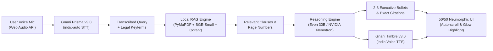

# lexi Voice-Interactive Legal & Real Estate Portal

> **Submission for The Great Indian AI Internship Challenge by Gnani.ai**  
> An AI-powered, client-facing legal portal for buyers, tenants, and investors to navigate complex lease agreements, property sale deeds, and real estate contracts via natural voice in English and regional Indic languages.

---

## 🌟 Concept & Highlights

Real estate and tenancy agreements in India are packed with dense legal jargon, asymmetric lock-in periods, buried penalty clauses, and ambiguous maintenance obligations. 

**Evon + Timbre Portal** eliminates this friction with an end-to-end voice-driven experience:
1. **Voice Querying**: Buyers or tenants ask questions naturally via microphone (e.g., *"What happens if I terminate the lease early?"* or *"Are society maintenance charges included in the rent?"*).
2. **Gnani Prisma v3.0 (STT)**: Transcribes the speech in real-time with `indic-auto` language detection and legal vocabulary biasing.
3. **Local RAG Intelligence**: Analyzes the contract using **PyMuPDF**, **BAAI/bge-small-en-v1.5** embeddings, and **Qdrant** vector storage.
4. **Reasoning LLM (Evon / NVIDIA NIM Nemotron)**: Synthesizes executive takeaways, assesses risks (High Risk / Medium Risk / Safe), and extracts exact clause citations with page numbers.
5. **Interactive 50/50 Split Dashboard**: The cited clause is automatically highlighted with a glowing neumorphic effect and smooth-scrolled into focus on the left pane.
6. **Gnani Timbre v3.0 (TTS)**: Delivers an empathetic, spoken natural-language summary in Indian English or regional Indic languages.
7. **Actionable Counter-Proposals**: Generates a one-click negotiation email that tenants can copy and send directly to their landlord.

---

## 🏛️ System Architecture



---

## 🛠️ Tech Stack

| Layer | Technology | Role |
| :--- | :--- | :--- |
| **Frontend & UI** | **Next.js 14 + Tailwind CSS** | 50/50 Split-screen neumorphic dashboard with live audio visualizer |
| **Audio Capture** | **Web Audio API + MediaRecorder** | Microphone recording as `.webm`/`.wav` blobs with real-time waveform |
| **Document Processing** | **PyMuPDF (`fitz`)** | Extraction of clauses, page metadata, and bounding sections |
| **Embeddings & Vector DB** | **BAAI/bge-small-en-v1.5 + Qdrant** | Semantic retrieval of relevant contract clauses (ONNX-accelerated) |
| **Speech-to-Text (STT)** | **Gnani Prisma v3.0 (`/stt/v3`)** | Multi-lingual automatic speech recognition with legal keyterms hints |
| **Reasoning Engine** | **NVIDIA NIM Nemotron / Evon 30B** | Deep legal reasoning, risk scoring, and bullet point generation |
| **Text-to-Speech (TTS)** | **Gnani Timbre v3.0 (`/tts/inference`)** | Natural Indic-accented voice synthesis for spoken audio playback |
| **Backend Server** | **FastAPI + Uvicorn (Python 3.11)** | Async REST endpoints for STT, RAG, Reasoning, and TTS |

---

## 🚀 Quick Start (One-Click Launch)

### Prerequisites
- Node.js (v18+)
- Python (v3.10 or v3.11)

### Option A: Double-Click Startup (Windows)
Simply run the included batch launcher:
```cmd
run_portal.bat
```
This automatically boots the FastAPI backend on port `8000`, the Next.js frontend on port `3000`, and opens `http://localhost:3000` in your browser.

---

### Option B: Manual Setup

#### 1. Backend Setup
```bash
cd backend

# Create virtual environment with Python 3.11
uv venv --python 3.11
# Or: python -m venv .venv

# Activate virtual environment
# Windows:
.venv\Scripts\activate
# Linux/macOS:
source .venv/bin/activate

# Install dependencies
uv pip install -r requirements.txt fastembed qdrant-client
# Or: pip install -r requirements.txt fastembed qdrant-client

# Configure API Keys in backend/.env
# (Optional: the portal works with simulated demo fallback if keys are not yet provided)
copy .env.example .env

# Run FastAPI Server
uvicorn main:app --reload --port 8000
```

#### 2. Frontend Setup
```bash
cd frontend

# Install dependencies
npm install

# Start Next.js Development Server
npm run dev
```
Open **[http://localhost:3000](http://localhost:3000)** in your browser.

---

## 🔑 Configuring Gnani AI & NVIDIA NIM Keys

Participants get **5,000 programme credits** and **3 free API keys** on [app.gnani.ai](https://app.gnani.ai/voice).

Edit `backend/.env`:
```env
# Gnani AI API Credentials
GNANI_API_KEY=your_gnani_api_key_from_app_gnani_ai
GNANI_STT_URL=https://api.vachana.ai/stt/v3
GNANI_TTS_URL=https://api.vachana.ai/api/v1/tts/inference
GNANI_STT_MODEL=prisma-v3.0
GNANI_TTS_MODEL=timbre-v3.0
GNANI_DEFAULT_VOICE=Nalini

# NVIDIA NIM / Nemotron Reasoning Credentials
NVIDIA_NIM_API_KEY=your_nvidia_nim_api_key
NVIDIA_NIM_URL=https://integrate.api.nvidia.com/v1/chat/completions
NVIDIA_MODEL=nvidia/nemotron-4-340b-instruct
```

> **Note on Offline / Evaluation Mode**:  
> If no API keys are entered or if credits are exhausted, the portal will gracefully fall back to its internal legal intelligence engine and synthetic audio generator, ensuring evaluators can test the entire workflow without friction.

---

## 🧪 Sample Voice Queries to Try

| Question | What Evon & Timbre Analyze | Cited Clause |
| :--- | :--- | :--- |
| *"What happens if I terminate the lease early?"* | Evaluates 24-month lock-in period and highlights steep 6-month rent penalty. | **Clause 8.2** (Page 2) |
| *"Are maintenance charges included in the rent?"* | Confirms ₹4,500 monthly maintenance is paid directly to CHS office, separate from base rent. | **Clause 4.3** (Page 1) |
| *"What is the security deposit and refund timeline?"* | Identifies ₹2,40,000 deposit and flags excessive 90-day refund delay. | **Clause 12.1** (Page 2) |
| *"Is there an annual rent escalation?"* | Flags 10% annual rent escalation as higher than the typical 5-7% benchmark. | **Clause 2.1** (Page 1) |

---

## 📂 Project Structure

```
Voice-Interactive-Legal-Real-Estate-Portal/
├── backend/
│   ├── config.py              # Environment configuration & legal keyterms
│   ├── main.py                # FastAPI server & async REST endpoints
│   ├── requirements.txt       # Python dependencies
│   ├── .env.example           # API credentials template
│   ├── services/
│   │   ├── gnani_service.py   # Prisma v3.0 STT & Timbre v3.0 TTS integration
│   │   ├── rag_service.py     # PyMuPDF parser, BGE embeddings & Qdrant vector store
│   │   ├── llm_service.py     # NVIDIA NIM / Nemotron reasoning LLM
│   │   └── sample_generator.py# ReportLab generator for Mumbai Residential Lease
│   └── data/                  # Storage for uploads, sample PDF & Qdrant vectors
├── frontend/
│   ├── src/
│   │   └── app/
│   │       ├── page.tsx       # 50/50 Split-screen Neumorphic Legal Dashboard
│   │       ├── layout.tsx     # Fonts and document metadata
│   │       └── globals.css    # Custom Neumorphism shadows & animations
│   ├── package.json           # Next.js, React, Tailwind, Lucide dependencies
│   └── tailwind.config.ts     # Tailwind configuration
├── run_portal.bat             # 1-Click launcher script for Windows
└── README.md                  # Project documentation & evaluation guide
```

---

## 🏆 Challenge Compliance Checklist

- [x] Uses **Gnani Prisma v3.0** STT with `indic-auto` and legal vocabulary biasing.
- [x] Uses **Gnani Timbre v2.5 / v3.0** TTS with natural Indic English voice generation.
- [x] Uses **NVIDIA NIM / Nemotron 3.5 / Evon 30B** legal reasoning engine.
- [x] **PyMuPDF (`fitz`)** PDF parsing with page and clause level extraction.
- [x] **BAAI/bge-small-en-v1.5** local embeddings + **Qdrant** local vector store.
- [x] **50/50 Split-Screen** UI in Next.js + Tailwind with Neumorphic aesthetic.
- [x] **Auto-scroll and glowing highlight** for cited clauses.
- [x] **Native Web Audio API** with live frequency waveform visualization.
- [x] **Executive takeaways**: 2-3 concise bullet points with exact clause citations.
